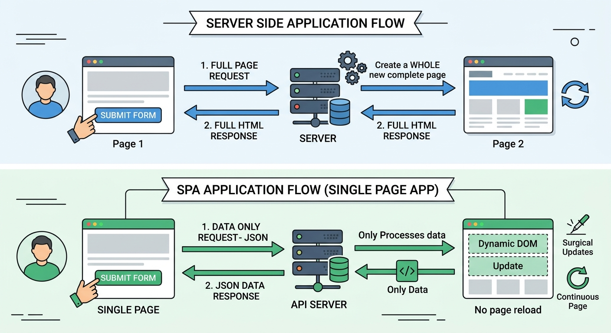

## Conversion of the Simple MVC with DB to a Single Page Application(SPA) with Web API

### Single Page Applications(SPA) and RESTful Web API vs. Server-Side Apps

**Server-Side Web Application**: An architecture where the server is responsible for routing, business logic, database operations, and rendering complete HTML pages (often using template engines like EJS). Every user action (like submitting a form) triggers a **full-page request and reload**.

---

**Single Page Application (SPA):** A web application that loads a single HTML shell once. As the user interacts with the app, client-side JavaScript dynamically updates the Document Object Model (DOM) and communicates asynchronously with the server, **eliminating full-page reloads**.

**RESTful Web API:** A decoupled backend interface that exposes endpoints (URLs) which accept requests and return raw data (typically formatted as JSON) rather than pre-rendered views.

---

### File-by-File Comparison

| Component | Old Server-Side Application | New SPA & Web API Application |
| --- | --- | --- |
| **Server Routing (`server.js`)** | Renders server-side templates (`res.render("manageUsers", ...)`), causing full page refreshes on form submission. | Serves static assets (`express.static`) and exposes RESTful JSON endpoints (`res.json`). |
| **Data Model (`models/userDB.js`)** | Executes SQL queries and passes raw database results back to the server controller via callbacks. | **Maintains identical callback structure** to execute MySQL queries and return results to the API layer. | 
| **Front-End View (`manageUsers.ejs` vs. `public/index.html`)** | Uses server-side Embedded JavaScript tags (`<% users.forEach(...) %>`) to loop and render table rows on the server. | Uses a static HTML shell with a container element (`<tbody id="userTableBody">`) populated dynamically by client-side JavaScript. |
| **Client Script (`public/js/app.js`)** | *None.* Logic was handled entirely via browser default form submissions and full-page reloads. | Handles asynchronous `fetch()` calls, DOM manipulation, client-side form validation, and event listeners using `async/await`. |
